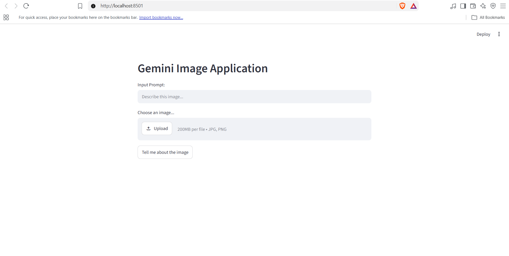

# Gemini LLM Chatbot & Vision AI

An AI-powered application built using **Python, Streamlit, and Google Gemini API**. This project demonstrates conversational AI, technical question answering, and image understanding through two interactive applications.

##  Project Overview

This project contains three applications:

- **Gemini Chatbot:** An interactive chatbot for answering technical and general questions.
- **Gemini Vision AI:** An image-analysis application that accepts uploaded images and generates AI-powered descriptions and insights.
- **Gemini Q&A Demo:** A basic question-and-answer interface using the Gemini API.

##  Features

### 1. Gemini Chatbot
- Interactive chatbot powered by Google Gemini.
- Supports technical and general-purpose questions.
- Short, Medium, and Detailed response options.
- Maintains conversation history during the session.
- Supports contextual follow-up questions.
- Clear chat functionality.


### Technical Question Answering


### Contextual Conversations


### Code Generation


### 2. Gemini Vision AI

- Upload images in JPG, JPEG, and PNG formats.
- Analyze image content using Gemini's multimodal capabilities.
- Generate image descriptions and insights.
- Accept custom prompts for image analysis.



##  Technologies Used

- Python
- Google Gemini API
- Google Gen AI SDK (`google-genai`)
- Streamlit
- Pillow
- Python Dotenv

##  Project Structure

```text
Gemini-llm/
│
├── app.py
├── chatbot.py
├── vision.py
├── check_models.py
├── test_gemini.py
├── requirements.txt
├── .gitignore
├── .env.example
├── README.md
│
└── screenshots/
```

##  Installation and Setup

### Step 1: Clone the repository

```bash
git clone https://github.com/vishalpeddaraju/Gemini-llm.git
cd Gemini-llm
```

### Step 2: Create a virtual environment

```bash
python -m venv .venv
```

### Step 3: Activate the virtual environment

**Windows PowerShell:**

```powershell
.\.venv\Scripts\Activate.ps1
```

### Step 4: Install dependencies

```bash
python -m pip install -r requirements.txt
```

### Step 5: Configure your Gemini API key

Create a `.env` file in the project root directory and add:

```env
GEMINI_API_KEY=your_gemini_api_key
```

Get your API key from [Google AI Studio](https://aistudio.google.com/apikey).

**Important:** Never upload your `.env` file or expose your API key on GitHub.

##  Run the Applications

### Run Gemini Chatbot

```bash
python -m streamlit run chatbot.py
```

### Run Gemini Vision AI

```bash
python -m streamlit run vision.py
```

### Run Basic Gemini Q&A Demo

```bash
python -m streamlit run app.py
```

##  Learning Outcomes

Through this project, I explored:

- Integrating Google Gemini API with Python applications.
- Building interactive AI applications using Streamlit.
- Managing conversational context and chat history.
- Implementing multimodal AI for image understanding.
- Managing API keys securely using environment variables.
- Handling API errors and model availability issues.

##  Author

**P Vishal**

GitHub: [vishalpeddaraju](https://github.com/vishalpeddaraju)

---

 If you find this project useful, feel free to explore the repository and share your feedback!